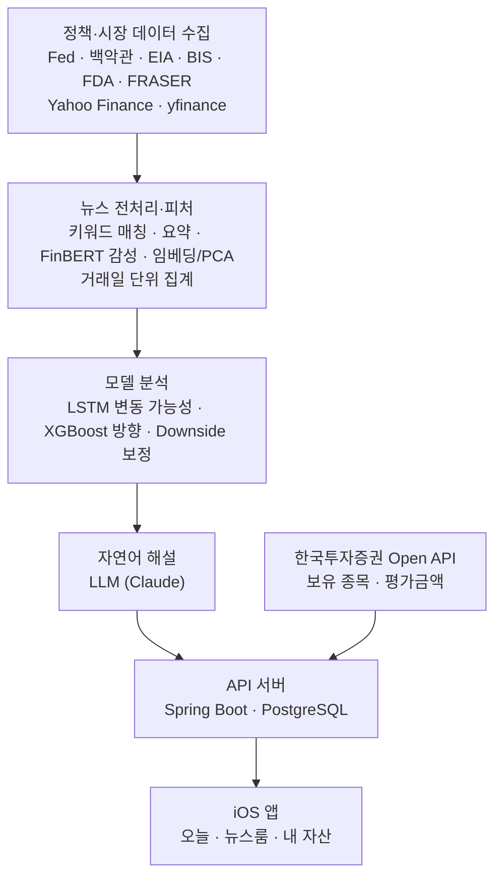
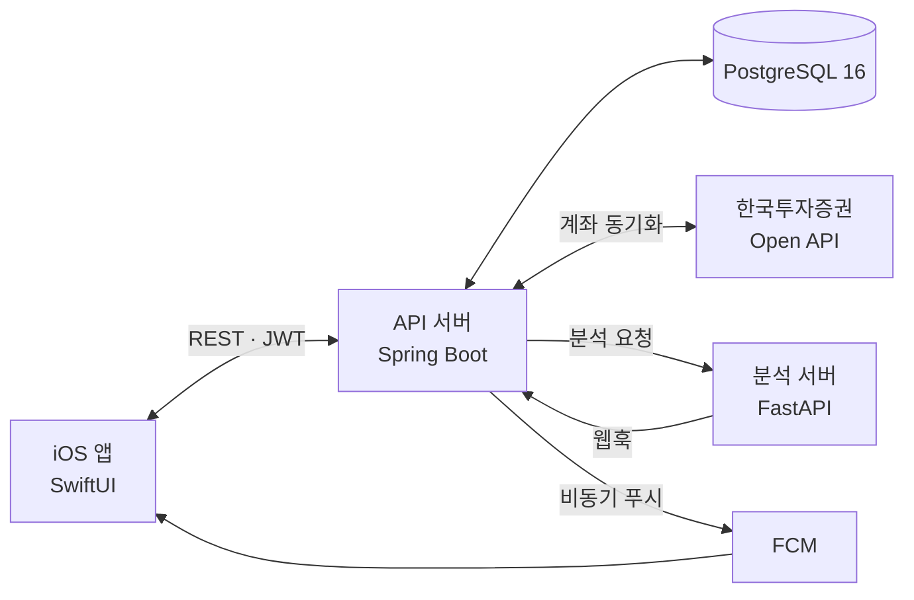

# Holdings Lab · 이건 홀딩스

**정책 뉴스와 시장 데이터를 활용한 개인화 자산 브리핑 서비스**

정책·경제 뉴스와 시장 데이터를 분석해, 내 보유 종목에 **큰 변동이 올지**와 **어느 방향일지**를 판단합니다. 그 판단의 **근거를 자연어로 설명**해 iOS 앱에 전달합니다.

2026 소프트웨어학부 졸업작품 · 30조 · 팀원 엄지용 · 이석호 · 이찬준 · 함민식 · 지도교수 문승현 교수님

> 전시 포스터의 QR로 들어오셨다면, 아래에서 포스터에 다 담지 못한 데이터·모델·서버 구성을 자세히 볼 수 있습니다.

<br>

## 목차

1. [Why](#why)
2. [앱 기능](#앱-기능)
3. [전체 구성](#전체-구성)
4. [데이터 수집](#데이터-수집)
5. [전처리와 피처](#전처리와-피처)
6. [모델](#모델)
7. [자연어 해설 (LLM)](#자연어-해설-llm)
8. [실험 결과](#실험-결과)
9. [서버](#서버)
10. [보안](#보안)
11. [저장소](#저장소)
12. [향후 개선](#향후-개선)

<br>

## Why

- 정책·경제 뉴스는 많지만, **내 자산과 어떤 관련이 있는지** 해석하기 어렵습니다.
- 뉴스·시세·계좌 정보가 서로 다른 곳에 흩어져 있습니다.
- AI가 판단을 줘도 **무엇을 근거로 했는지** 알 수 없으면 그대로 믿기 어렵습니다(블랙박스).

그래서 뉴스, 시장 분석, 보유 자산을 한곳에 모으고 **AI 판단의 근거까지 함께** 보여줍니다.

<br>

## 앱 기능

| 탭 | 사용자가 알 수 있는 것 |
| --- | --- |
| **오늘** | 내 자산이 지금 괜찮은지(고점 대비 상태), 어떤 종목을 가장 많이 들고 있는지, 목표 대비 진행률 |
| **뉴스룸** | 내 보유 종목에 어떤 뉴스가 있었고, AI가 왜 그렇게 판단했는지 ("AI는 이렇게 판단했어요") |
| **내 자산** | 원화 환산 총 평가금액과 종목별 보유 내역·손익 |

<p align="center">
  
  <br><sub>뉴스룸 상세 화면 (TestFlight 빌드)</sub>
</p>

<br>

## 전체 구성



- 분석 서버(FastAPI)가 매일 정해진 시각에 수집 → 전처리 → 모델 추론 → 해설 생성을 자동으로 실행합니다.
- API 서버(Spring Boot)는 결과를 사용자의 보유 종목과 연결해 앱에 전달합니다.
- 계좌 정보는 **모델 입력에 쓰지 않고**, API 서버에서 분석 결과와 결합합니다.

<br>

## 데이터 수집

| 구분 | 출처 | 수집 내용 |
| --- | --- | --- |
| 통화정책 | Federal Reserve | FOMC 성명, 의사록, Implementation Note |
| 대통령 문서 | UCSB American Presidency Project | 행정명령, 포고문, 각서, 성명, 기자회견 |
| 에너지 | EIA | 단기 에너지 전망(STEO), Today in Energy |
| 국제 금융 | BIS | 보도자료·뉴스 |
| 헬스케어 | FDA | 보도자료 |
| 경제 사료 | FRASER (St. Louis Fed) | 키워드 기반 문서 |
| 뉴스 | Yahoo Finance | 종목·섹터 관련 기사 |
| 시세 | yfinance | 대상 ETF(QQQ · XLE · XLF · XLV)와 SPY · VIX · TLT · HYG · UUP 등 보조 지표 |

<br>

## 전처리와 피처

1. **키워드 매칭·중복 제거**: 섹터별 키워드로 관련 문서를 고르고, 같은 URL은 한 번만 남깁니다.
2. **본문 요약**: 긴 정책 문서를 로컬 LLM(Ollama)으로 요약합니다.
3. **FinBERT 감성 점수**: 금융 특화 언어모델로 문서의 긍정·부정 점수를 계산합니다.
4. **문장 임베딩 → PCA 축소**: 요약문을 임베딩한 뒤 저차원으로 압축합니다. PCA는 학습 구간에서만 학습해 미래 정보 누수를 막습니다.
5. **거래일 단위 집계**: 문서를 날짜별 숫자 피처(문서 수, 감성 추이 등)로 묶고 시장 피처(수익률·변동성·기술 지표·보조 티커)와 결합합니다.

모델에는 뉴스 원문이 직접 들어가지 않고, 이렇게 만든 **일별 숫자 피처**만 들어갑니다.

<br>

## 모델

'큰 변동이 올지'와 '어느 방향일지'는 서로 다른 문제라서 모델을 나눴습니다.

| 단계 | 모델 | 하는 일 |
| --- | --- | --- |
| 변동 가능성 | **LSTM** × 2 | 뉴스 피처 시계열과 시장 피처 시계열을 각각 LSTM으로 분석하고, 두 점수를 **50%씩 결합**해 이벤트 점수를 만듭니다. 큰 변동은 **향후 16거래일 수익률의 절댓값이 2% 이상**인 경우입니다. |
| 경고 수준 | 임계값 | 시장 하락 구간(깊음·중간·얕음)마다 다른 임계값을 적용해 **Normal · High Confidence · Strong** 3단계 경고를 만듭니다. |
| 방향 | **XGBoost** | 과거 큰 변동이 있었던 날의 시장 피처만 학습해 상승 확률을 내고, 기준값에 따라 UP · DOWN을 판정합니다. QQQ · XLE · XLF · XLV별로 모델과 기준값이 따로 있습니다. |
| 하락 보정 | **Downside** | 시장 Drawdown, 뉴스 이벤트 확률, XGBoost 상승 확률이 종목별 조건을 만족하면 하락 전용 경고를 우선 적용합니다. |

**모델을 나눠서 얻은 점**

- 방향 모델이 평소의 작은 가격 등락을 학습하지 않습니다.
- 모델을 다시 학습하지 않고 기준값만 바꿔 경고 빈도와 정밀도를 조절할 수 있습니다.
- 변동 가능성과 방향의 근거를 따로 설명할 수 있어 블랙박스를 줄입니다.

**평가 방식**: 분기별 walk-forward로 평가합니다. 각 평가 분기마다, 예측 대상 날짜가 그 분기 이전인 데이터로만 학습해 미래 정보를 쓰지 않습니다.

<br>

## 자연어 해설 (LLM)

모델이 낸 숫자를 사용자가 읽을 수 있는 문장으로 바꿉니다.

- **입력**: 종목, 예측 기간, 예측 방향, 상승 확률, 예상 수익률, 시장 상태, 관련 뉴스
- **출력**
  - 판단 요약 (한 문장)
  - 근거 (2~3문장)
  - 뉴스와 예측의 일치도: 지지(SUPPORTIVE) · 혼재(MIXED) · 상반(CONTRADICTORY) · 근거 부족(INSUFFICIENT)
  - 사용한 원문 URL
- 점수를 투자 판단으로 단정하지 않고, "본 내용은 투자 판단의 근거가 아닙니다" 문구를 함께 보여줍니다.

**실제 서버 응답 예시** (QQQ, 2026-09-25 기준)

| 입력 | 출력 |
| --- | --- |
| 예측 기간 15일 · 상승 확률 약 60%<br>뉴스: 미국 10년물 국채 금리 2007년 이후 최고<br>뉴스: Alphabet 주가 하락 | **"QQQ는 향후 15일간 큰 변동 없이 횡보할 가능성이 높습니다"**<br>근거: AI 투자 수익성에 대한 긍정적 신호와, 국채 금리 상승·AI 인프라 투자 부담 같은 부정 요인이 상충 |

<br>

## 실험 결과

모델은 주가(가격)를 맞히는 것이 아니라, **향후 16거래일 안에 2% 이상 큰 변동이 올지**와 **그 방향**을 예측합니다.

### 경고는 대체로 맞았지만, 큰 변동을 미리 잡는 비율은 아직 낮습니다

| 질문 | 10번 중 | 원래 지표 (4개 종목 범위) |
| --- | --- | --- |
| 경고가 울렸을 때 실제로 큰 변동이 왔나 | **7–8번** | 정밀도 71–78% |
| 방향(상승/하락)까지 맞혔나 | **약 5번** | 경고+방향 적중 46–55% |
| 실제 큰 변동을 미리 경고했나 | **1–4번** | 재현율 12–38% (한계) |

- 가장 보수적인 Strong 경고(QQQ)는 방향을 **10번 중 7번 이상(73.5%)** 맞혔지만, 큰 변동을 미리 잡은 비율은 8.9%에 그칩니다. 경고 기준을 높일수록 정확해지는 대신 놓치는 변동이 늘어납니다.
- Downside 보정으로 4개 종목 모두 하락 경고 정확도가 올랐습니다.

| 종목 | 정밀도 | 재현율 | 경고+방향 적중 | 하락 경고 정확도 (보정 전 → 후) |
| --- | ---: | ---: | ---: | ---: |
| QQQ | 77.9% | 38.4% | 48.1% | 50.7% → 58.1% |
| XLE | 77.5% | 31.7% | 53.2% | 23.5% → 49.2% |
| XLF | 73.2% | 18.7% | 54.7% | 61.1% → 61.9% |
| XLV | 71.3% | 12.1% | 45.5% | 23.5% → 48.6% |

과거 데이터 평가 결과입니다(분기별 walk-forward, Downside 보정 후). 실시간 운영 성능이나 수익률을 의미하지 않습니다.

<br>

## 서버



| 영역 | 구현 |
| --- | --- |
| 역할 분리 | Spring Boot는 사용자·자산 API, FastAPI는 수집·분석·모델 추론 |
| 자동 실행 | 분석 서버는 APScheduler로 매일 수집·신호 산출. API 서버는 Spring Scheduler로 전일 자산 스냅샷, 계좌 동기화(하루 2회), 60초 간격 백그라운드 동기화 |
| 증권사 연동 | 한국투자증권 Open API — 접근 토큰 관리, 계좌·보유 종목 동기화, 모의투자·실전 모드 전환 |
| LLM 운영 | 뉴스 본문 요약은 로컬 LLM(Ollama), 해설은 Claude API |
| 알림 | 분석 서버가 웹훅(비밀키 검증)으로 이벤트를 보내면 비동기로 FCM 푸시 |
| 데이터베이스 | PostgreSQL 16 + JPA, Flyway 마이그레이션으로 스키마 버전 관리 |
| 배포 | GitHub Actions에서 Docker 이미지를 빌드해 GHCR에 올리고 AWS Lightsail에 자동 배포. Docker Compose로 DB·API·분석 서버·LLM을 함께 운영, 헬스체크 포함 |

<br>

## 보안

| 대상 | 처리 |
| --- | --- |
| 증권사 API 키 | AppKey·AppSecret을 AES-256으로 암호화해 저장하고, 호출할 때만 복호화 |
| 비밀번호 | BCrypt 해시로만 저장, 원문은 보관하지 않음 |
| 액세스 토큰 | JWT(HS256 서명), 30분 후 만료 |
| 리프레시 토큰 | 서버에는 SHA-256 해시만 저장. 사용할 때마다 새로 발급(회전)하고 로그아웃하면 폐기 |
| 앱 저장소 | 토큰을 iOS Keychain에 이 기기에서만 열리도록 보관 |
| 비밀값·데이터 분리 | 서명·암호화 키는 환경변수로 주입. 계좌 정보는 모델 입력에 쓰지 않음 |

<br>

## 저장소

| 저장소 | 내용 | 주요 기술 |
| --- | --- | --- |
| [data-ml](https://github.com/Holdings-lab/data-ml) | 정책·뉴스 수집, 전처리, 모델 학습·평가 | Python · PyTorch · XGBoost · FinBERT |
| [backend-api](https://github.com/Holdings-lab/backend-api) | API 서버와 분석 서버, 배포 | Spring Boot · FastAPI · PostgreSQL · Docker |
| [iOS-app](https://github.com/Holdings-lab/iOS-app) | 오늘 · 뉴스룸 · 내 자산 앱 | SwiftUI |

<br>

## 향후 개선

- **모델 성능 개선**: 자산별·기간별 검증, 확률 보정
- **해설 정확성 검증**: 생성된 해설과 원문 뉴스의 일치도 평가
- **사용자 이해도 평가**: 실사용자 테스트
- **실계좌 연결**: 한국투자증권 실계좌 연동과 운영
- **대화형 매매**: 매수·매도 버튼 대신, 앱 안의 LLM 채팅봇과 대화하며 매수·매도

<br>

## Team

- 엄지용 (UI/UX, Feature 설계)
- 이석호 (데이터 수집, DB 관리)
- 이찬준 (모델링, ETF 데이터)
- 함민식 (백엔드, API)

<br>

# 📝 Commit Convention

[Conventional Commits](https://www.conventionalcommits.org/) 기반 커밋 규칙.
PR 머지 / changelog 자동화.

<br>

## 한 줄 요약

```
<type>(<scope>): <subject>

<body>

<footer>
```

- `type`, `subject`만 필수, 나머지는 선택
- 각 블록 사이는 **빈 줄 한 줄**로 구분

<br>

## Type

| Type       | 언제 쓰는데?                                     |
| ---------- | ------------------------------------------------ |
| `feat`     | 새 기능 추가                                     |
| `fix`      | 버그 수정                                        |
| `docs`     | 문서만 수정 (README, 주석 등)                    |
| `style`    | 포맷팅, 세미콜론 같은 것만 (동작 변경 X)         |
| `refactor` | 기능 그대로 두고 코드만 갈아엎기                 |
| `perf`     | 성능 개선                                        |
| `test`     | 테스트 추가/수정                                 |
| `build`    | 빌드/의존성 (npm, pip, gradle 등)                |
| `ci`       | CI 설정 (GitHub Actions 등)                      |
| `chore`    | 그 외 잡일                                       |
| `revert`   | 이전 커밋 되돌리기                               |

<br>

## Subject 쓸 때 규칙

- **50자 이내**
- **명령문**으로 — `add`, `fix`, `remove` (✅)  /  `added`, `fixing` (❌)
- **마침표 금지**
- 영문은 소문자로 시작 (한글이면 그냥 자연스럽게)

```
✅ feat(auth): add OAuth2 login
❌ feat(auth): Added OAuth2 login.
```

<br>

## Body / Footer

**Body** — "뭘 했는지" 적기. 한 줄 72자 정도에서 끊기.

**Footer** — 이슈 연결 / Breaking Change 표시

```
Closes #123
Fixes #456
Refs #789
```

호환성 깨지는 변경은 `!` 붙이거나 footer에 명시:

```
feat(api)!: change getUser to async

BREAKING CHANGE: 기존 동기 호출부 전부 await 붙여야 함
```

<br>

## Scope 예시

프로젝트 구조 따라 자유롭게.

```
feat(auth): ...
fix(api): ...
refactor(model): ...
docs(readme): ...
```

<br>

## 실제 예시

**가장 단순:**
```
fix: typo in README
```

**scope 포함:**
```
feat(auth): add Google OAuth2 login
```

**본문까지:**
```
refactor(parser): split tokenizer into separate module

parser.ts 가 1000줄 넘어가서 가독성 망함.
토크나이저 분리해서 단위 테스트 쉽게 작성할 수 있게 함.

Refs #102
```

**ML 프로젝트 예시:**
```
feat(model): add FashionMNIST baseline CNN

Conv2d → ReLU → MaxPool → FC 구조 baseline.
test accuracy 89.4%.

Refs #5
```

<br>

## 권장사항

- **커밋 1개 = 변경 1개.** 섞이면 `git add -p` 로 쪼개기
- **WIP 커밋 금지** (어쩔 수 없으면 머지 전 squash)
- PR을 **Squash and merge** 로 머지하면 PR 제목이 곧 커밋이 되니까, **PR 제목도 같은 컨벤션** 으로 쓰기

<br>

## 치트시트 🧾

```
feat:     기능 추가
fix:      버그 수정
docs:     문서
style:    포맷팅
refactor: 리팩터링
perf:     성능
test:     테스트
build:    빌드/의존성
ci:       CI
chore:    잡일
revert:   되돌리기
```

```
<type>(<scope>): <subject>   ← 50자, 명령문, 마침표 ❌

<body>                       ← "왜" 했는지, 72자 줄바꿈

<footer>                     ← Closes #123 / BREAKING CHANGE
```
