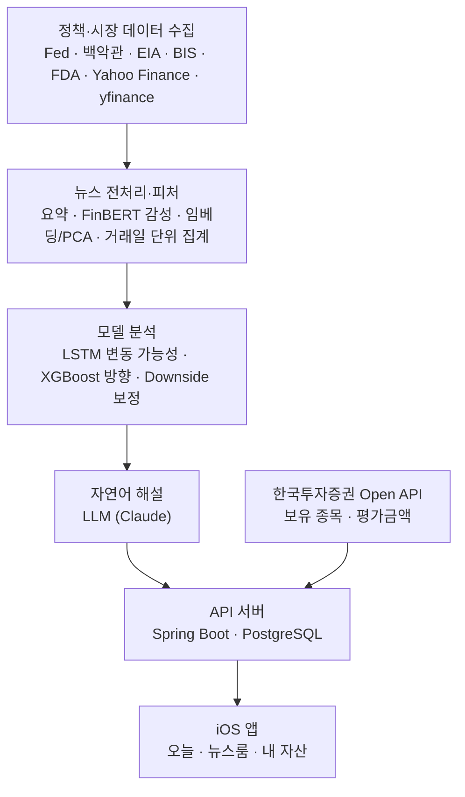

# Holdings Lab · 이건 홀딩스

**정책 뉴스와 시장 데이터를 활용한 개인화 자산 브리핑 서비스**

정책·경제 뉴스와 시장 데이터를 분석해 내 보유 종목에 큰 변동이 올지, 어느 방향일지를 판단합니다. 그 판단의 **근거를 자연어로 설명**해 iOS 앱에 전달합니다.

2026 소프트웨어학부 졸업작품 · 30조 · 지도교수 문승현 교수님

<br>

## Why

- 정책·경제 뉴스는 많지만, **내 자산과 어떤 관련이 있는지** 해석하기 어렵습니다.
- 뉴스·시세·계좌 정보가 서로 다른 곳에 흩어져 있습니다.
- AI가 판단을 줘도 **무엇을 근거로 했는지** 알 수 없으면 그대로 믿기 어렵습니다(블랙박스).

그래서 뉴스, 시장 분석, 보유 자산을 한곳에 모으고 AI 판단의 근거까지 함께 보여줍니다.

<br>

## App

| 탭 | 사용자가 알 수 있는 것 |
| --- | --- |
| **오늘** | 내 자산이 지금 괜찮은지, 어떤 종목을 가장 많이 들고 있는지 |
| **뉴스룸** | 내 종목에 어떤 뉴스가 있었고, AI가 왜 그렇게 판단했는지 |
| **내 자산** | 총 평가금액과 종목별 보유 내역·손익 |

<br>

## How It Works



계좌 정보는 모델 입력에 쓰지 않고, API 서버에서 분석 결과와 결합합니다.

<br>

## Core Technology

### 데이터 분석 및 AI

| 단계 | 모델 | 역할 |
| --- | --- | --- |
| 변동 가능성 | **LSTM** (뉴스 · 시장 각각) | 두 점수를 50%씩 결합해 이벤트 점수 산출. 큰 변동 = 향후 16거래일 수익률 절댓값 2% 이상. 하락 구간별 임계값으로 Normal · High Confidence · Strong 경고 |
| 방향 | **XGBoost** | 과거 큰 변동 구간의 시장 피처만 학습해 UP · DOWN 판정. QQQ · XLE · XLF · XLV별 별도 모델 |
| 하락 보정 | **Downside** | 시장 Drawdown, 뉴스 이벤트 확률, 상승 확률이 종목별 조건을 만족하면 하락 경고 우선 |
| 해설 | **LLM** | 점수·방향·시장 상태와 관련 뉴스로 판단 요약, 근거, 뉴스와의 일치도, 사용한 원문 URL 생성 |

**LSTM과 XGBoost를 나눈 이유.** '큰 변동이 올지'와 '어느 방향일지'는 서로 다른 문제입니다. 나눠서 얻은 이점은 세 가지입니다.

- 방향 모델이 평소의 작은 등락을 학습하지 않습니다.
- 재학습 없이 기준값만으로 경고 빈도와 정밀도를 조절할 수 있습니다.
- 변동 가능성과 방향의 근거를 따로 설명할 수 있습니다.

### 서버

- **두 서버로 역할 분리**: Spring Boot는 사용자·자산 API, FastAPI는 수집·분석·모델 추론
- **자동 실행**: APScheduler로 매일 수집·신호 산출, Spring Scheduler로 자산 스냅샷·계좌 동기화
- **한국투자증권 Open API**: 토큰 관리, 계좌·보유 종목 동기화, 모의·실전 모드 전환
- **LLM 운영**: 뉴스 본문 요약은 로컬 LLM(Ollama), 해설은 Claude API
- **알림**: 분석 서버 → 웹훅(비밀키 검증) → 비동기 FCM 푸시
- **배포**: GitHub Actions → GHCR → AWS Lightsail, Docker Compose

<br>

## Results

과거 데이터 평가이며, 실시간 운영 성능이나 수익률을 의미하지 않습니다. (16거래일 기준, 분기별 walk-forward, Downside 보정 후)

| 종목 | 이벤트 정밀도 | 이벤트 재현율 | 경고+방향 적중률 | 하락 정확도 (보정 전 → 후) |
| --- | ---: | ---: | ---: | ---: |
| QQQ | 77.9% | 38.4% | 48.1% | 50.7% → 58.1% |
| XLE | 77.5% | 31.7% | 53.2% | 23.5% → 49.2% |
| XLF | 73.2% | 18.7% | 54.7% | 61.1% → 61.9% |
| XLV | 71.3% | 12.1% | 45.5% | 23.5% → 48.6% |

QQQ의 가장 보수적인 Strong 경고는 방향 정확도 73.5%, 경고·방향 동시 적중률 58.1%를 기록했습니다. 대신 이벤트 재현율은 8.9%로, 정확도를 높일수록 놓치는 이벤트가 늘어납니다.

<br>

## Security

- 증권사 API 키(AppKey·AppSecret)는 AES-256으로 암호화해 저장
- 비밀번호는 BCrypt 해시로만 저장
- 액세스 토큰은 JWT(HS256), 30분 후 만료
- 리프레시 토큰은 서버에 SHA-256 해시만 저장하고, 사용할 때마다 재발급
- 앱 토큰은 iOS Keychain에 이 기기에서만 열리도록 보관
- 서명·암호화 키는 환경변수로 주입하고, 계좌 정보는 모델 입력에 쓰지 않음

<br>

## Repositories

| 저장소 | 내용 | 주요 기술 |
| --- | --- | --- |
| [data-ml](https://github.com/Holdings-lab/data-ml) | 정책·뉴스 수집, 전처리, 모델 학습·평가 | Python · PyTorch · XGBoost · FinBERT |
| [backend-api](https://github.com/Holdings-lab/backend-api) | API 서버와 분석 서버, 배포 | Spring Boot · FastAPI · PostgreSQL · Docker |
| [iOS-app](https://github.com/Holdings-lab/iOS-app) | 오늘 · 뉴스룸 · 내 자산 앱 | SwiftUI |

<br>

## Next

- 모델 성능 개선: 자산별·기간별 검증, 확률 보정
- 해설 정확성 검증: 해설과 원문 뉴스의 일치도 평가
- 사용자 이해도 평가: 실사용자 테스트
- 한국투자증권 실계좌 연결과 운영
- LLM 채팅봇과 대화하며 매수·매도하는 대화형 매매

<br>

## Team

- 엄지용 (UI/UX, Feature 설계)
- 이석호 (데이터 수집, DB 관리)
- 이찬준 (모델링, ETF 데이터)
- 함민식 (백엔드, API)

<br>

# 📝 Commit Convention

[Conventional Commits](https://www.conventionalcommits.org/) 기반 커밋 규칙.
PR 머지 / changelog 자동화.

<br>

## 한 줄 요약

```
<type>(<scope>): <subject>

<body>

<footer>
```

- `type`, `subject`만 필수, 나머지는 선택
- 각 블록 사이는 **빈 줄 한 줄**로 구분

<br>

## Type

| Type       | 언제 쓰는데?                                     |
| ---------- | ------------------------------------------------ |
| `feat`     | 새 기능 추가                                     |
| `fix`      | 버그 수정                                        |
| `docs`     | 문서만 수정 (README, 주석 등)                    |
| `style`    | 포맷팅, 세미콜론 같은 것만 (동작 변경 X)         |
| `refactor` | 기능 그대로 두고 코드만 갈아엎기                 |
| `perf`     | 성능 개선                                        |
| `test`     | 테스트 추가/수정                                 |
| `build`    | 빌드/의존성 (npm, pip, gradle 등)                |
| `ci`       | CI 설정 (GitHub Actions 등)                      |
| `chore`    | 그 외 잡일                                       |
| `revert`   | 이전 커밋 되돌리기                               |

<br>

## Subject 쓸 때 규칙

- **50자 이내**
- **명령문**으로 — `add`, `fix`, `remove` (✅)  /  `added`, `fixing` (❌)
- **마침표 금지**
- 영문은 소문자로 시작 (한글이면 그냥 자연스럽게)

```
✅ feat(auth): add OAuth2 login
❌ feat(auth): Added OAuth2 login.
```

<br>

## Body / Footer

**Body** — "뭘 했는지" 적기. 한 줄 72자 정도에서 끊기.

**Footer** — 이슈 연결 / Breaking Change 표시

```
Closes #123
Fixes #456
Refs #789
```

호환성 깨지는 변경은 `!` 붙이거나 footer에 명시:

```
feat(api)!: change getUser to async

BREAKING CHANGE: 기존 동기 호출부 전부 await 붙여야 함
```

<br>

## Scope 예시

프로젝트 구조 따라 자유롭게.

```
feat(auth): ...
fix(api): ...
refactor(model): ...
docs(readme): ...
```

<br>

## 실제 예시

**가장 단순:**
```
fix: typo in README
```

**scope 포함:**
```
feat(auth): add Google OAuth2 login
```

**본문까지:**
```
refactor(parser): split tokenizer into separate module

parser.ts 가 1000줄 넘어가서 가독성 망함.
토크나이저 분리해서 단위 테스트 쉽게 작성할 수 있게 함.

Refs #102
```

**ML 프로젝트 예시:**
```
feat(model): add FashionMNIST baseline CNN

Conv2d → ReLU → MaxPool → FC 구조 baseline.
test accuracy 89.4%.

Refs #5
```

<br>

## 권장사항

- **커밋 1개 = 변경 1개.** 섞이면 `git add -p` 로 쪼개기
- **WIP 커밋 금지** (어쩔 수 없으면 머지 전 squash)
- PR을 **Squash and merge** 로 머지하면 PR 제목이 곧 커밋이 되니까, **PR 제목도 같은 컨벤션** 으로 쓰기

<br>

## 치트시트 🧾

```
feat:     기능 추가
fix:      버그 수정
docs:     문서
style:    포맷팅
refactor: 리팩터링
perf:     성능
test:     테스트
build:    빌드/의존성
ci:       CI
chore:    잡일
revert:   되돌리기
```

```
<type>(<scope>): <subject>   ← 50자, 명령문, 마침표 ❌

<body>                       ← "왜" 했는지, 72자 줄바꿈

<footer>                     ← Closes #123 / BREAKING CHANGE
```
